# ใครพูด เปิดหน้าไหน โชว์อะไร

**เปิดไว้ 3 แท็บ:** A = Dashboard (pttep.vercel.app) · B = Notebook / ydata · C = Dataiku (Q1 Regression)
⚠️ **ห้ามเปิด** เมนู "สัญญาณ" และบทวิเคราะห์ข้อ 5 (เป็นส่วน Classification ที่ไม่ได้พูด)

---

### คนที่ 1 · Dashboard → บทวิเคราะห์ → ข้อ 1
โชว์: ย่อหน้า Business Problem (−51%) และการ์ด 3 ด้าน
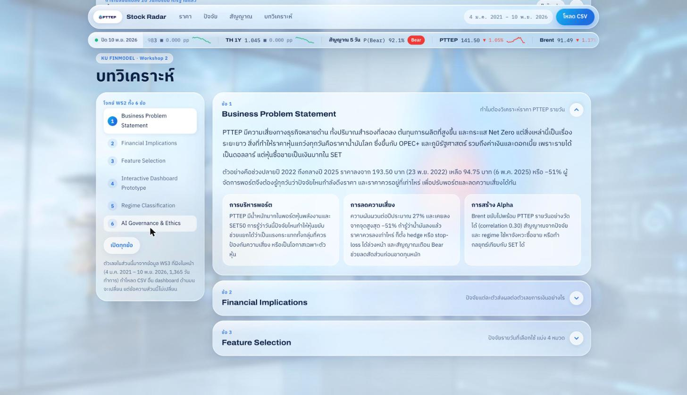

### คนที่ 2 · Dashboard → บทวิเคราะห์ → ข้อ 2 แล้วต่อด้วยข้อ 3
โชว์: ตาราง Financial Implications → กล่องปัจจัย 4 หมวด
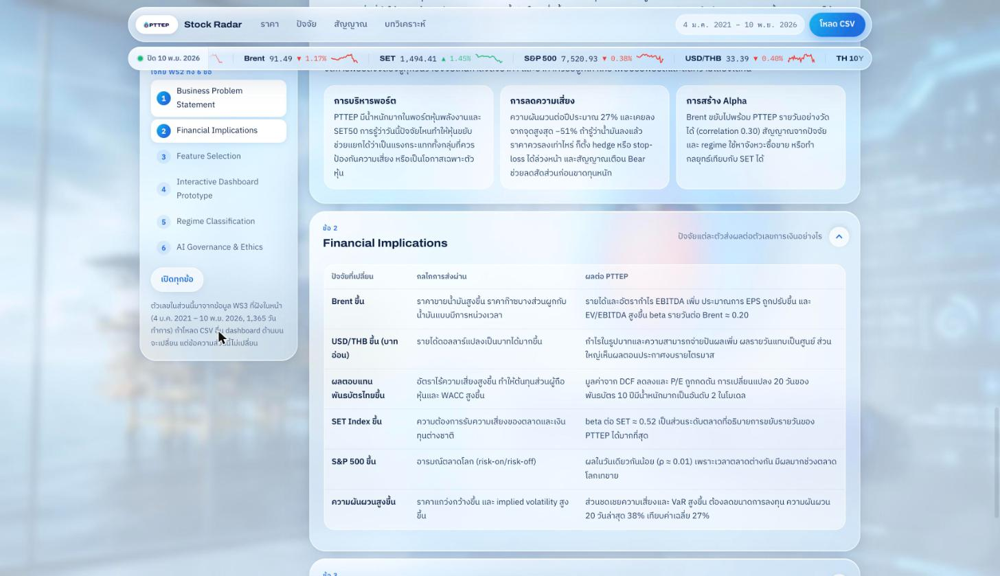
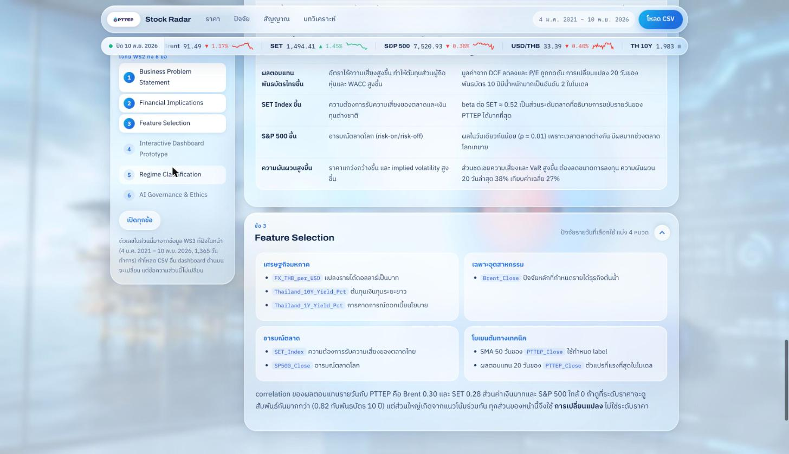

### คนที่ 3 · Notebook WS3 → รายงาน ydata
โชว์: ใน notebook ส่วนดึงข้อมูลและเติมค่าพันธบัตร → ใน ydata หน้า Overview (1,365 แถว, Missing 0)
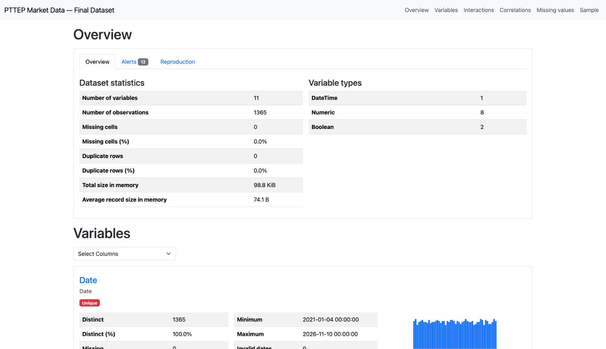

### คนที่ 4 · Dashboard → หน้าแรก แล้วต่อด้วยเมนู "ปัจจัย"
โชว์: แถบราคาด้านบน → ลากหมุนกราฟ 3 มิติ (ป้าย ρ) → เปิดการ์ด Brent (ρ 60 วัน 0.33)
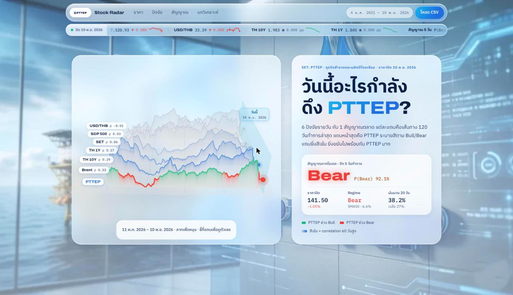
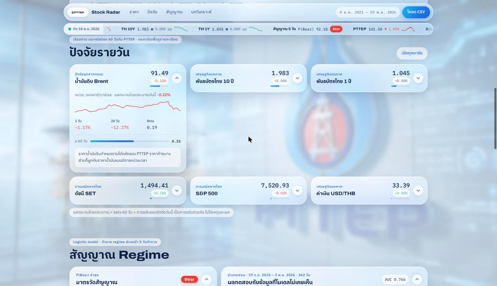

### คนที่ 5 · Dataiku → Q1 Regression → RESULT → SESSIONS
โชว์: 6 โมเดล และ Train 1,107 / Test 258 แถว
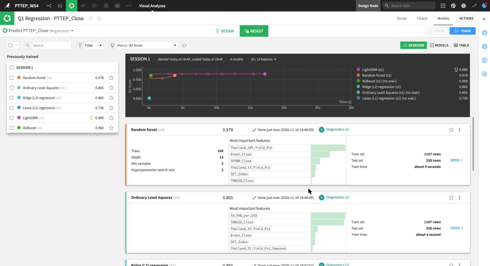

### คนที่ 6 · Dataiku → RESULT → TABLE
โชว์: คอลัมน์ R2 Score และ MAE (LightGBM 0.980 สูงสุด, Lasso 0.730 ต่ำสุด)
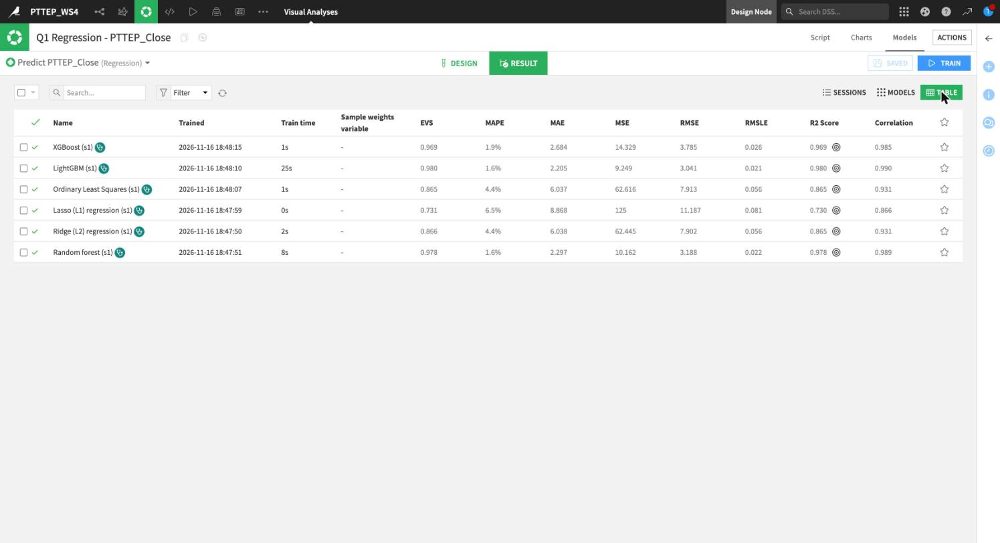

### คนที่ 7 · Dataiku → คลิก LightGBM (s1) → Feature importance แล้วต่อด้วย What-if?
โชว์: กราฟ Shapley (10Y 41%, Brent 25%) → What-if ที่ใส่ค่าวันที่ 6 พ.ย. ไว้แล้ว (ทาย 144) → แก้ Brent เป็น 117.64 (ได้ 150) → แก้ 10Y เป็น 2.09 (ได้ 157)
⚠️ ค่า What-if ไม่ถูกบันทึก **ต้องใส่ค่าวันที่ 6 พ.ย. ใหม่ก่อนพรีเซนต์**: 10Y 1.988 · Brent 98.32 · 1Y 1.04 · SP500 7376.86 · SET 1465.7 · THBUSD 0.029911 · FX 33.432 (กดปุ่มดินสอของแต่ละช่องเพื่อพิมพ์ค่า)
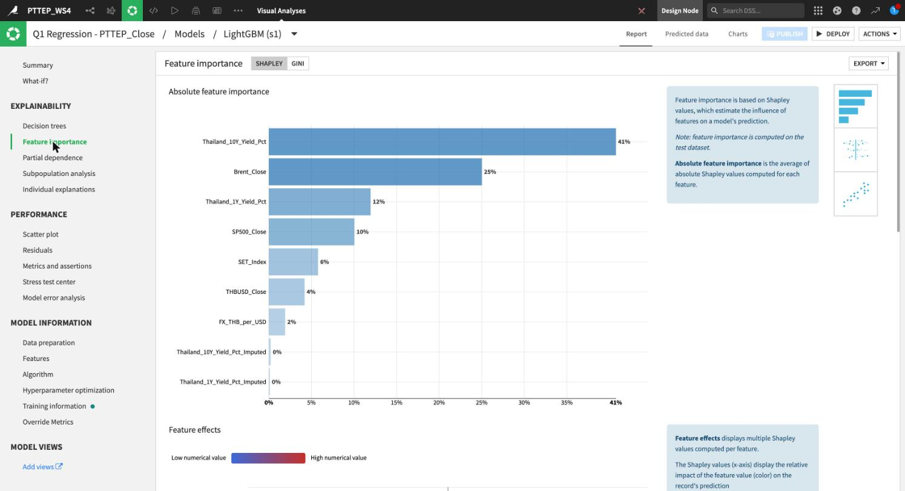
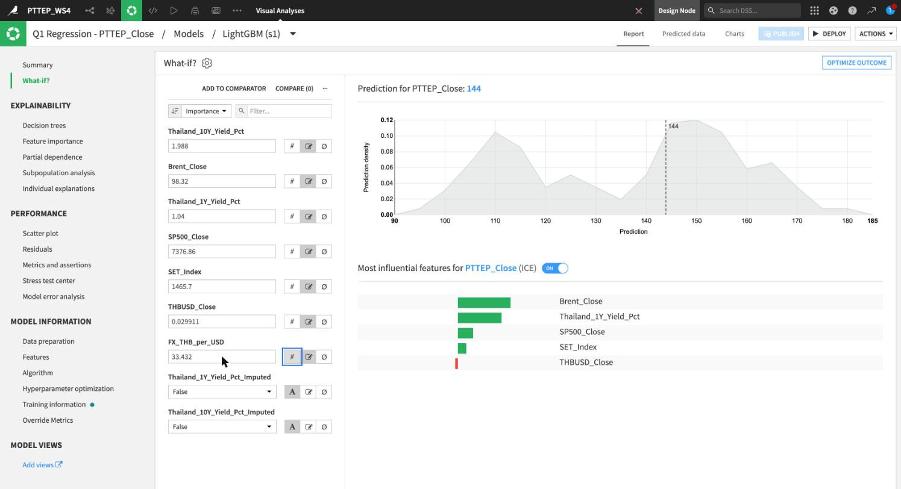

### คนที่ 8 · Dashboard → บทวิเคราะห์ → ข้อ 6
โชว์: **เฉพาะฝั่งขวา** "ความโปร่งใสและจริยธรรม" → ท้ายหน้า "ไม่ใช่คำแนะนำการลงทุน"
(ฝั่งซ้ายเป็นของโมเดล Classification ห้ามอ่าน)
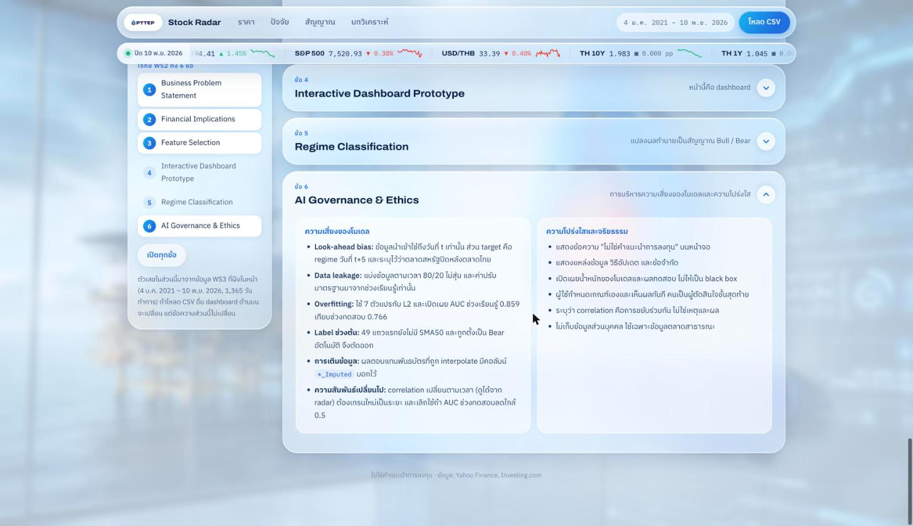
